<!-- ══════════════════════════════════════════════════════════════════════════
     AMINE ZIANI — RED TEAM OPERATOR  ·  anime night-ops dossier
     Animated scene = banner.svg (original vector art, animates on GitHub).
     ══════════════════════════════════════════════════════════════════════════ -->

<p align="center">
  
</p>

<p align="center">
  
  
  
</p>

<p align="center">
  
  
  
  
  
</p>

---

## `> whoami`

```text
● ACCESS GRANTED
Offensive Security Engineer — I break into enterprises so they can't be broken.
I lead full-scope penetration tests and red-team engagements: initial access →
lateral movement → full domain compromise, mapped to MITRE ATT&CK, and I write
the report that makes it fixable.

  callsign   AMINE ZIANI
  rank       Hack The Box · OMNISCIENT · #1 Morocco · Top 10 Global
  pro labs   14 completed (AD forests · multi-host pivot · enterprise compromise)
  arena      Active Directory · Web/API · Network · Exploit Dev
  rule       authorized engagements only
```

---

## ⚔️ ARSENAL

**Active Directory & Windows**

<p align="center">
  
  
  
  
  
  
</p>

**Web / API · Network · Exploit Dev**

<p align="center">
  
  
  
  
  
</p>

**Tooling & Scripting**

<p align="center">
  
  
  
  
  
  
  
  
  <br/>
  
  
  
  
</p>

---

## 🏅 CERTIFICATIONS

<p align="center">
  
  
  
  
  
  <br/>
  
  
  
  
</p>

---

## 🧪 HACK THE BOX — PRO LABS

> **14 completed** — advanced AD-forest exploitation, multi-host pivoting, enterprise compromise & web chains.

<p align="center">
  
  
  
  
  
  
  
  
  <br/>
  
  
  
  
  
  
</p>

---

## ✍️ HTB — AUTHORED MACHINES & CHALLENGES

> I don't just root boxes — I build the ones that make *you* sweat.

| Name | Type | Difficulty | What it teaches |
|:-----|:----:|:----------:|:----------------|
| **ARBITER** | 🪟 Windows | 🔴 Insane | Advanced Windows internals + full AD attack chains |
| **Waybill** | 🪟 Windows | 🟠 Hard | Multi-stage enterprise misconfig → privilege escalation |
| **Ephemera** | 💥 Pwn | 🔴 Insane | glibc 2.39 heap internals & modern allocator corruption |
| **Prism** | 🔐 Crypto | 🟠 Hard | Cryptographic protocol-weakness exploitation |
| **Echoes** | 🔐 Crypto | 🟠 Hard | Subtle implementation flaws in encryption schemes |

---

## 💼 EXPERIENCE

```text
▸ Penetration Tester  ·  Exploit Flux LTD  ·  UK (Remote)       2026 → present
    Full-scope network / web / multi-domain AD engagements · MITRE ATT&CK
    adversary simulation · CVSS-scored reporting for tech + exec stakeholders.

▸ Penetration Tester  ·  ISP Security Co  ·  US (Remote)        2026
    Enterprise AD & web pentests · critical privesc chains · hardening advisory.

▸ Independent Security Consultant  ·  Freelance                 2021 → 2026
    VA/PT for SMBs & startups · remediation roadmaps · custom Python tooling.
```

---

## 📊 STATS

<p align="center">
  
  
</p>

<p align="center">
  
</p>

<p align="center">
  
</p>

<p align="center">
  
</p>

<p align="center">
  
</p>

---

## 📮 CONTACT

<p align="center">
  <a href="https://amine2211-max.github.io/portfolio/"></a>
  <a href="https://linkedin.com/in/amine-ziani"></a>
  <a href="mailto:ziani3618@gmail.com"></a>
  <a href="https://github.com/AMINE2211-max"></a>
</p>

<p align="center"><sub>🌍 Morocco · available internationally · open to relocation &amp; remote</sub></p>

---

<p align="center">
  
</p>

<p align="center"><sub>— <i>Amine Ziani</i> · <code>● ACCESS GRANTED</code></sub></p>
